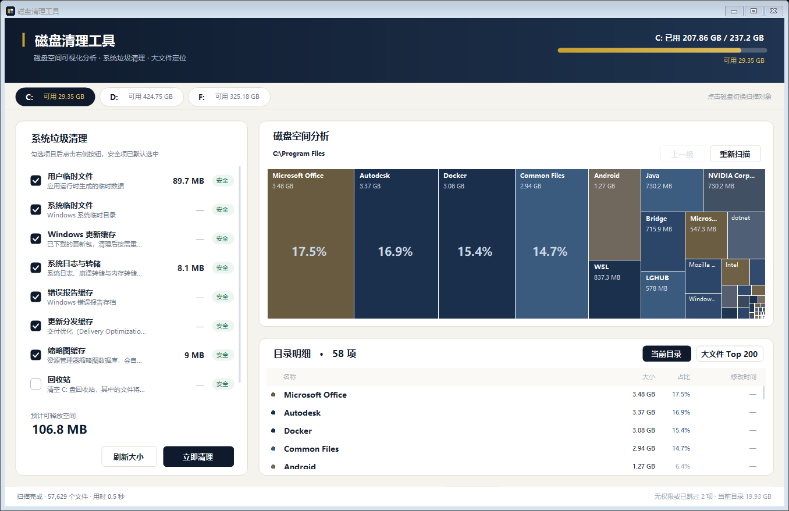
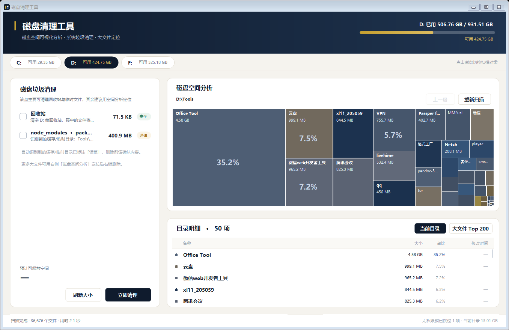

# 磁盘清理工具

面向 Windows 的磁盘空间可视化分析与垃圾清理工具。C# WinForms 编写，编译为**单文件 exe**，免安装、无第三方依赖。



## 功能特性

- **磁盘空间可视化**：SpaceSniffer 风格的矩形树图（Treemap），按实际占用面积绘制，双击进入子目录、面包屑回退、悬浮查看占比
- **多磁盘切换**：顶部列出所有本地固定磁盘及可用空间，点击即切换扫描对象
- **系统垃圾清理**：用户/系统临时文件、Windows 更新缓存、系统日志与内存转储、错误报告、交付优化缓存、缩略图缓存、浏览器缓存、Windows.old、休眠文件
- **非系统盘清理**：按盘清空回收站、清理该盘 `Temp` 目录；扫描完成后自动识别 `node_modules`、`.cache`、`Cache`、`Temp`、`Downloads` 等常见缓存目录（≥100 MB，最多 5 个，标注「谨慎」）
- **目录明细 / 大文件 Top 200**：表格与树图联动，双击定位、右键打开或删除
- **安全优先**：删除路径白名单校验、操作前二次确认、清理项按「安全 / 谨慎」分级，默认只勾选安全项

## 截图

多磁盘切换与非系统盘缓存识别：



## 下载

前往 [Releases](https://github.com/BlackRiceArcher/disk-cleaner/releases) 下载 `磁盘清理工具.exe`，双击运行即可（会请求管理员权限，清理系统目录必需）。

## 使用说明

1. 启动后允许 UAC 提权；程序默认扫描 Windows 所在盘
2. 顶部点击盘符切换要分析的磁盘
3. 左侧勾选清理项 → 点「立即清理」；可先点「刷新大小」重新统计
4. 右侧树图：双击进入目录，右键「打开位置 / 删除到回收站 / 永久删除」，顶部「上一级」回退
5. 底部可在「当前目录」与「大文件 Top 200」之间切换，支持排序与右键操作

## 安全说明

- 删除对象经过路径白名单校验，不会触碰系统根目录、`Windows`、`Program Files` 等关键位置
- 批量清理前弹出确认框，逐项显示大小；自动识别项会显示完整路径
- 程序不联网、不写注册表、不安装服务、不创建后台进程，关闭即结束
- exe 未做数字签名，首次运行可能触发 SmartScreen 提示，选择「仍要运行」即可

## 系统要求

- Windows 10 / 11（64 位）
- .NET Framework 4.8（Win10 1903+ / Win11 自带）
- 32 位系统未适配

## 从源码构建

需要 .NET Framework 4.8 与 Roslyn 编译器（Visual Studio 或 Build Tools 自带）：

```powershell
powershell -ExecutionPolicy Bypass -File Source\build.ps1
```

脚本会自动查找 `csc.exe`，输出 `磁盘清理工具.exe` 到仓库根目录。

## 项目结构

```
Source/
  Program.cs        入口与启动参数
  MainForm.cs       主窗口、布局与交互逻辑
  HeaderBar.cs      顶部磁盘概况
  DriveBar.cs       磁盘切换条
  TreemapView.cs    矩形树图渲染与交互
  TreemapLayout.cs  树图布局算法（squarified treemap）
  DiskScanner.cs    多线程磁盘扫描
  Cleaner.cs        清理项定义、体积统计与清理执行
  CleanupList.cs    清理项列表控件
  ItemList.cs       明细 / 大文件列表
  Breadcrumb.cs     路径面包屑
  Theme.cs          配色、字体与圆角绘制
  Model.cs          目录节点模型
  build.ps1         一键编译脚本
```

## 已知限制

- 仅枚举本地固定磁盘，不含 U 盘、移动硬盘与网络映射盘
- 非系统盘的缓存识别基于目录名匹配，结果需人工确认后再清理
- 未做代码签名，「发布者」显示为未知属正常现象

## 许可证

[MIT](LICENSE) © 2026 Ahtea
